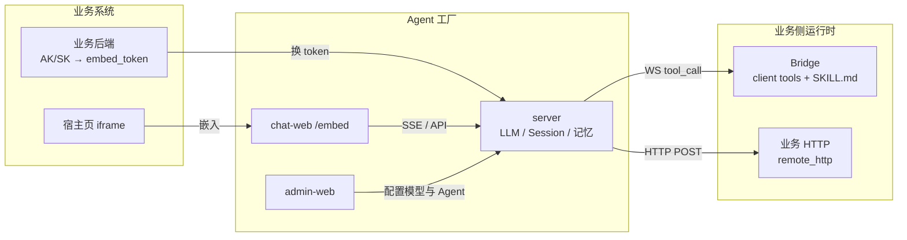
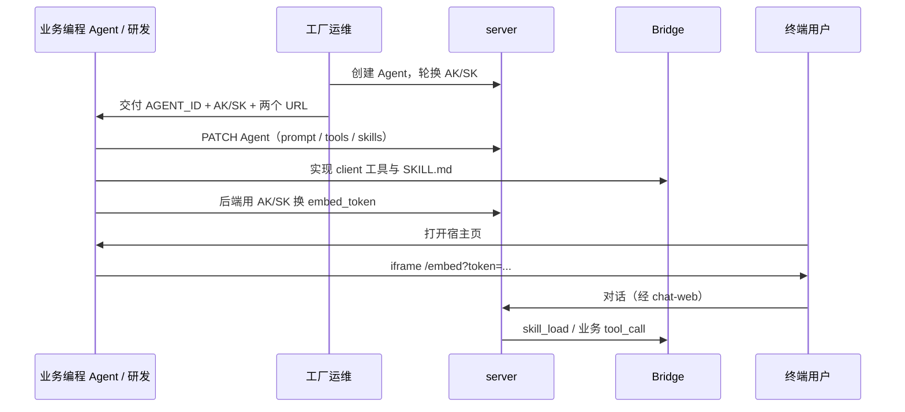

# Agent工厂（agent-factory）

多业务共用的 **Agent Runtime**：开箱即用推理、会话、记忆、工具调度与官方聊天页，可**快速搭出能力齐全的 Agent 服务与前端**；各业务只需用自己的 prompt / tools / skills 差异化，对话页面用 iframe 嵌入。

**Agent 实例 / 客户端负责**：差异化配置（prompt / tools / skills）、嵌入位置、本机或业务侧工具执行。  
**工厂负责**：怎么想、怎么记、怎么把工具过程聊清楚。

### 适用场景 / 优势

适合**快速做多个业务 Agent**：流式对话、会话回放、记忆、上下文压缩、Ask/审批、聊天 UI、嵌入鉴权等**通用能力由工厂统一提供**，接入方不必在每个 Agent 里重复造。

每个 Agent 实例只需补齐**特有能力**——系统提示词、业务 tools、Skills 正文、Bridge / HTTP 回调——用配置 + 少量客户端胶水即可上线，缩短从「想法」到「可嵌入对话」的周期。

也适合：旧项目换底座（iframe 试点）、工具必须跑在本机/内网、同一套 Runtime 服务多条产品线。

| 工厂（通用能力） | Agent 实例 / 客户端（独有能力） |
|---|---|
| 推理循环、流式、取消 | 系统提示词与多语言模板 |
| Session 存储与回放、消息 / timeline | 业务 tools（`client` / `remote_http`） |
| 记忆、上下文压缩、Ask / 工具审批 | Skills 正文与本机/内网执行 |
| 官方聊天页 `/embed`、嵌入鉴权 | 嵌入位置、业务用户标识、Bridge 设备 |
| 模型接入、用量与配置 API | `ui_theme` 品牌色 / 圆角（嵌入页） |

---

## 怎么串起来



```text
业务宿主 ──iframe──► chat-web/embed ──SSE──► server（推理中心）
    │                                         │
    └── 后端 AK/SK 换 embed_token ─────────────┤
                                              ├── WS ──► Bridge（本机工具 / Skills）
                                              └── HTTP ► 业务 API（remote_http）
```

| 组件 | 作用 |
|---|---|
| **server** | ReAct 循环、Session、记忆、压缩、Ask/Approval、调度工具 |
| **chat-web** | 官方聊天 UI；业务嵌 `/embed` |
| **admin-web** | 模型、Agent、记忆、用量（运维） |
| **Bridge** | 执行 `client` 工具；本地 `skills/<name>/SKILL.md` |
| **业务后端** | 保管 AK/SK；换短时 `embed_token`；可选建 Session |

---

## 仓库结构

```text
agent-factory/
├── apps/server         # FastAPI 底座
├── apps/chat-web       # 官方聊天页（含 /embed）
├── apps/admin-web      # 管理台
├── apps/demo-bridge    # 本地 Tool Bridge 示例
├── apps/demo-web       # 业务侧 iframe 嵌入示例
└── packages/chat-ui    # 内部聊天组件
```

## 本地地址

| 服务 | 地址 |
|---|---|
| 工厂 API / OpenAPI | http://127.0.0.1:8000 · [/docs](http://127.0.0.1:8000/docs) |
| chat-web | http://localhost:8801 （嵌入 `/embed`） |
| admin-web | http://localhost:8802 |
| demo-web | http://localhost:8803 |
| Bridge WS | `ws://127.0.0.1:8000/api/client/connect` |

前端 API 基址：`VITE_API_BASE`（默认 `http://127.0.0.1:8000`）。

---

## 快速开始

### 1. 安装

```bash
cd agent-factory
cp .env.example .env
# 至少配置 OPENAI_API_KEY / OPENAI_API_BASE（或管理台里配模型）

uv sync
pnpm install
```

### 2. 启动

```bash
# 底座
uv run --project apps/server uvicorn agent_factory_server.main:app --reload --port 8000

# 前端（另开终端）
pnpm dev:admin   # :8802
pnpm dev:chat    # :8801
pnpm dev:demo    # :8803

# 本地工具（另开终端）
uv run --project apps/demo-bridge demo-bridge --server ws://127.0.0.1:8000 --device-id demo-mac
```

### 3. 走通一次对话

1. 管理台创建 Agent（默认可含 `echo` / `get_cwd` / `list_dir` 与 skill `workspace-scout`）
2. 轮换凭证，拿到 AK/SK；或打开 demo-web 选该 Agent
3. 对话里试 `echo`，或说「看看当前目录」→ `skill_load` → 本地工具

嵌入示例：

```text
http://localhost:8801/embed?agentId=<AGENT_ID>&token=<EMBED_TOKEN>&userKey=<USER_KEY>&userId=<USER_ID>&deviceId=demo-mac
```

- `userKey`：业务用户稳定 ID（记忆作用域）  
- `deviceId`：与 Bridge `--device-id` 一致  
- 提示词支持 `{{userId}}` 等；创建 Session 时用 `prompt_vars` 渲染进该会话快照  

---

## 业务怎么接入



文档：

| 文档 | 给谁 |
|---|---|
| [client-guide.md](docs/integration/client-guide.md) | 人读：宿主 / Bridge |
| [api-for-coding-agents.md](docs/integration/api-for-coding-agents.md) | 编程 Agent：API 契约 |
| [agent-factory-integrate/SKILL.md](docs/integration/agent-factory-integrate/SKILL.md) | 给编程 Agent：业务嵌页、换 token、改配置、Bridge（可复制到对方 `.cursor/skills/`） |

示例：`apps/demo-web`、`apps/demo-bridge`。

要点：日常改配置用**本 Agent AK/SK**（`PATCH /api/agents/{id}`），不要把平台总钥匙发给接入方。

---

## 能力一览

- 对话 / ReAct / 流式 / 取消；Ask User、工具审批（HITL）
- Session 回放、队列；上下文压缩；长期记忆
- Tools：`remote_http` | `client`；Skills 按需加载
- iframe 嵌入 + AK/SK → `embed_token`；Agent `ui_theme` 主题 token
- 模型 Key 落盘加密

设计细节：`docs/design/` · 路线图：[docs/roadmap.md](docs/roadmap.md)（不做多租户；CI 暂缓）

## 环境变量

见 [`.env.example`](.env.example)。

- `FACTORY_API_KEY` 为空时开发可不校验平台 Key  
- `OPENAI_API_BASE` 支持 OpenAI-compatible 网关；生产建议配 `MODEL_SECRETS_KEY`
